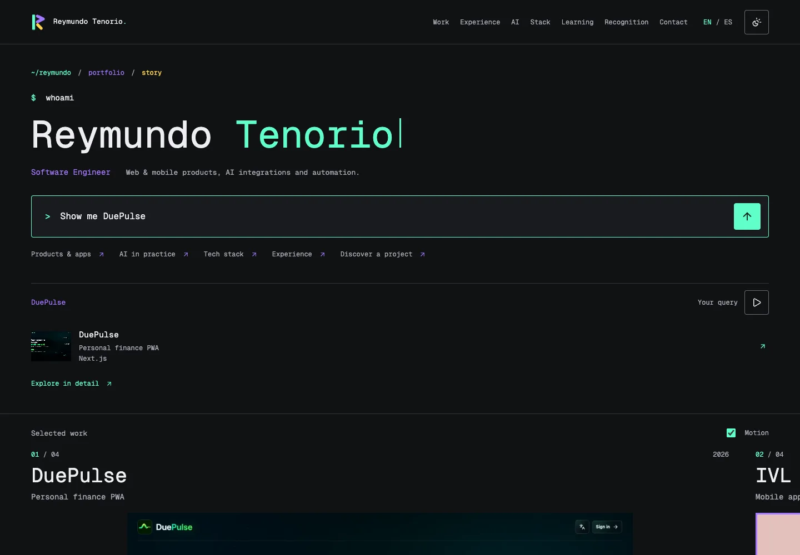

<p align="center">
  
</p>

<h1 align="center">Reymundo Tenorio</h1>
<p align="center">Software Engineer. Web and mobile products, applied AI, and automation.</p>
<p align="center">
  <a href="https://reymundotenorio.github.io/"><strong>Explore the portfolio</strong></a>
  &nbsp; / &nbsp;
  <a href="https://reymundotenorio.github.io/en/">English</a>
  &nbsp; / &nbsp;
  <a href="https://reymundotenorio.github.io/es/">Español</a>
</p>
<p align="center">
  <a href="https://github.com/reymundotenorio/reymundotenorio.github.io/actions/workflows/deploy.yml"></a>
  
  
  
</p>

[](https://reymundotenorio.github.io/)

## A Portfolio You Can Explore

A terminal-inspired introduction leads into selected work, then the full professional story. The interface is bilingual, statically rendered, and designed around real projects rather than decorative demos.

- **Ask or discover.** The prompt types and submits examples until you take control. Enter and prepared options reveal factual, local answers.
- **Browse selected work.** Desktop scrolling moves naturally into four horizontal project panels and back to vertical content. Mobile uses a native swipe rail.
- **Open the project.** Each of the 30 projects has its own English and Spanish page with large captures, contribution, implementation details, and technologies. Back restores your place.
- **Go deeper.** Experience, applied AI, a categorized tech stack, certifications, courses, recognition, education, and public code remain readable in HTML.
- **Choose your pace.** Dark/light themes, keyboard access, motion controls, and reduced-motion layouts are built in. Core content and links work without JavaScript.

**No AI service, API keys, or chatbot subscription.** Discovery runs locally with reviewed content and predefined matching. It does not generate answers or send questions to a server.

## Run Locally

Use **Node.js 24** and **pnpm 11.25.0**, the versions used by the deployment workflow.

```sh
pnpm install --frozen-lockfile
pnpm dev --port 4331
```

Open [localhost:4331](http://127.0.0.1:4331/). English is the default; Spanish is available at `/es/`.

```sh
pnpm test                   # Content, navigation, and demo logic
pnpm check                  # Astro and TypeScript diagnostics
pnpm build                  # Tests, checks, static build, SEO and byte budgets
pnpm preview --port 4332    # Serve the production build
```

### Browser Checks

Install Chromium once:

```sh
pnpm exec playwright install chromium
```

With the preview running in another terminal:

```sh
PORTFOLIO_BASE_URL=http://127.0.0.1:4332 pnpm test:e2e
```

The suite exercises both languages and themes, desktop wheel/touch navigation, project pages and return paths, prompt/autoplay, accessibility, responsive layouts, and no-JavaScript content. Screenshots, recordings, and JSON evidence stay outside the repository in `/tmp/portfolio-qa`.

`PORTFOLIO_QA_OUTPUT` changes the output directory. `PLAYWRIGHT_CHROMIUM_EXECUTABLE_PATH` selects an existing Chromium installation.

`pnpm test:release` starts and stops its own static preview, then runs the same browser suite. CI uses this gate before deployment. `PORTFOLIO_PREVIEW_PORT` selects an unused port when running it locally. Refresh the README capture with `PORTFOLIO_BASE_URL=http://127.0.0.1:4332 pnpm docs:preview`.

## Make It Your Own

| Area | Source |
| --- | --- |
| Bilingual professional content and 30 project cases | [`src/data/profile.json`](src/data/profile.json) |
| Categorized stack and applied-AI narrative | [`src/data/editorial.ts`](src/data/editorial.ts) |
| Curated, rotating demo questions | [`src/data/demo-tour.ts`](src/data/demo-tour.ts) |
| Homepage and project presentation | [`src/components`](src/components) |
| Project routes and sitemap | [`src/pages`](src/pages) |
| Prompt, motion, theme, and return behavior | [`src/scripts`](src/scripts) |
| Colors, fonts, spacing, and responsive styles | [`src/tokens.css`](src/tokens.css), [`src/style.css`](src/style.css) |
| Project captures and identity assets | [`public/images/projects`](public/images/projects), [`public/brand`](public/brand) |

Content is curated, not scraped at runtime. Keep stable project IDs aligned across languages. Add real contributions and source material; do not infer expertise from repository filenames or dependencies. Tests guard content coverage, safe links, and visible labels for conceptual or demo imagery.

## How It Works

**Astro builds the document. GSAP enhances the selected-work scene.** There is no SPA framework, database, answer API, or runtime server.

- `/` and `/en/` render the English portfolio; `/es/` renders Spanish.
- `/en/work/[id]/` and `/es/work/[id]/` are dedicated static project pages.
- Case pages load a small client entry without the carousel or prompt engine.
- Images get responsive WebP derivatives at build time. Full original captures remain available from the case pages.
- Canonical URLs, reciprocal language links, Open Graph, structured data, and the sitemap are generated with the content.
- Older complete-view URLs and retired minor-edit cases retain localized redirects. GitHub Pages serves static HTML redirects, not server-side HTTP 301 responses.

The Terminal R assembles on each fresh homepage load or reload, then joins the header in about 1.8 seconds. Any interaction or the Skip intro button dismisses it immediately. Deep links, project pages, Back/Forward navigation, hidden tabs, and disabled/reduced motion skip the sequence. An inline watchdog keeps content available even if the animation module cannot load; there is no fake loading progress or added animation dependency.

The demo waits for the intro, then pauses while scrolling, offscreen, or hidden. Real input takes manual control until Play. On short mobile screens, the automatic experience preview shows the current role; manual questions and the full experience section retain the complete progression. Cursor animation is independent of demo pause and respects reduced motion. Theme/motion preferences stay on-device; a browser history entry retains only the local state needed to return to your place, including the selected prompt response. Questions are not sent externally or put in URLs.

## Media & Attribution

Authentic captures take precedence over concepts. Conceptual artwork and demonstration data remain labeled. Public websites may include later work by other contributors.

Private application URLs, customer records, intermediary names, personal contact details, and private repository metadata are not part of the published portfolio. DuePulse uses signed-out product captures; Pouch is one anonymous shipping/tracking case. Workshop and participation records are distinguished from awards.

Geist Sans and Geist Mono are self-hosted with their [SIL Open Font License](public/fonts/GEIST-OFL.txt). Local Lucide assets retain their [license](public/icons/LICENSE). Project brands and imagery are credited to their respective owners; a public repository is not permission to reuse someone else's identity or client material.

## Publishing

An authorized push to `master` triggers [GitHub Actions](.github/workflows/deploy.yml):

```text
Install pinned dependencies -> tests & type checks -> static build
-> SEO/content/performance gates -> Pages artifact -> deploy
```

Feature branches do not publish automatically. The workflow deploys `dist/`; there is no manual upload or secret-bearing client configuration. The older root-level static snapshot is retained as history and is not the deployment source.

---

[Portfolio](https://reymundotenorio.github.io/) · [LinkedIn](https://www.linkedin.com/in/reymundotenorio/) · [GitHub](https://github.com/reymundotenorio)
